# Todo App
    Nama    : Wanhardo Jawak
    NRP     : 5025251155
    Prodi   : Teknik Informatika
    Kelas   : Pemrograman Web (A)

## Dokumentasi dan Preview E05

### Ringkasan Implementasi
- Pada E05, Todo App dari tugas sebelumnya dikembangkan menjadi Progressive Web App (PWA). Pengembangan ini dilakukan tanpa mengubah fitur yang sudah ada, seperti Personal, Shared, CRUD, dan upload foto.

Beberapa hal yang ditambahkan pada E05 antara lain:
- manifest.json digunakan untuk mengatur informasi aplikasi, seperti nama, icon, start URL, display mode, theme color, dan background color. File ini kemudian dihubungkan ke index.php agar browser dapat mengenali aplikasi sebagai PWA.
- sw.js digunakan untuk menyimpan beberapa resource penting ke dalam cache, termasuk app shell dan halaman offline. Service Worker juga mengatur penghapusan cache versi lama dan strategi caching untuk setiap resource.
- Tombol Install Aplikasi ditambahkan pada bagian header. Tombol ini muncul ketika browser mendukung proses instalasi dan akan disembunyikan setelah aplikasi berhasil dipasang.

### Strategi Caching
| Resource | Strategi | Alasan |
|---|---|---|
| Halaman PHP (navigasi) | Network First, fallback ke offline.html | Data todo bersifat dinamis dan dapat berubah, terutama pada menu Shared. |
| style.css dan script.js | Stale-While-Revalidate | Resource dapat langsung digunakan dari cache sambil diperbarui dari jaringan. |
| Ikon dan manifest.json | Cache First | Jarang berubah |
| uploads/ (foto todo) | Cache First | Nama file acak dan unik, isinya tidak berubah |
| Request POST (actions.php) | Network Only | Proses tambah, ubah, dan hapus todo tetap membutuhkan koneksi ke server |

### 1. Web App Manifest
- Manifest berhasil terdeteksi pada DevTools melalui bagian Application-Manifest.
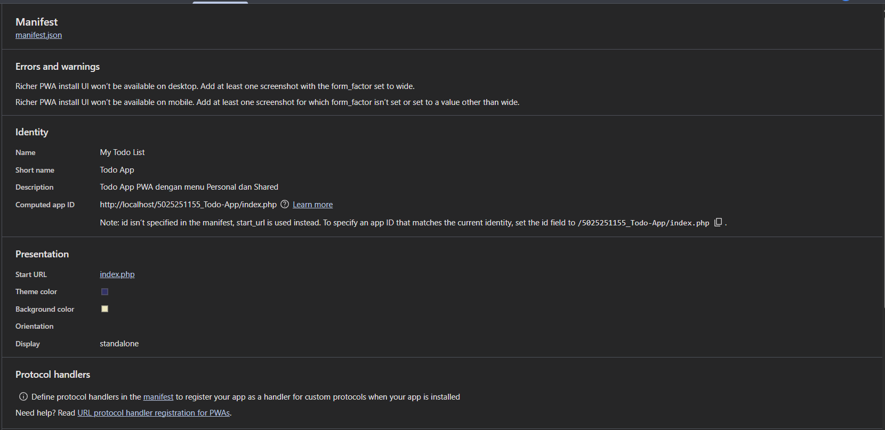
- Ikon aplikasi pada bagian Icons di panel Manifest
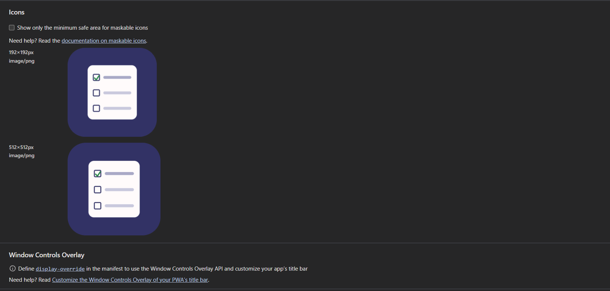

### 2. Service Worker dan Precache
- Service worker berstatus activated and is running
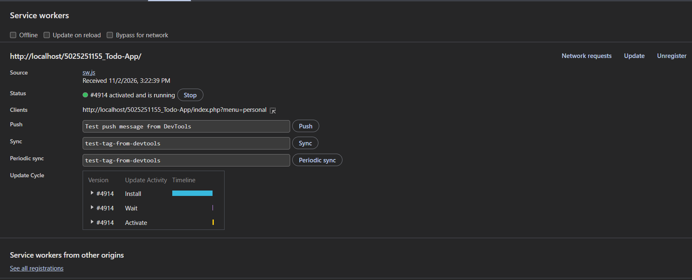
- Isi dari  Cache storage ada icon,  offline.html, style.css, script.js dam manifest.json
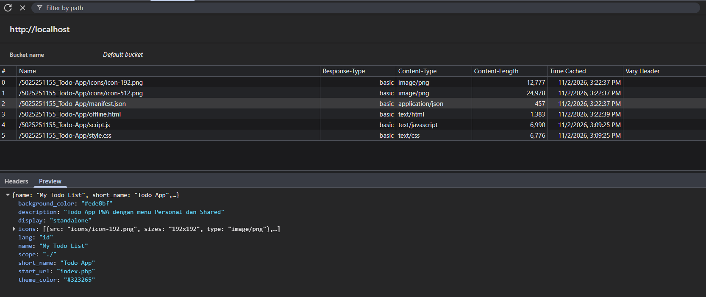

### 3. Install Button
- Tombol Install Aplikasi tampil di header
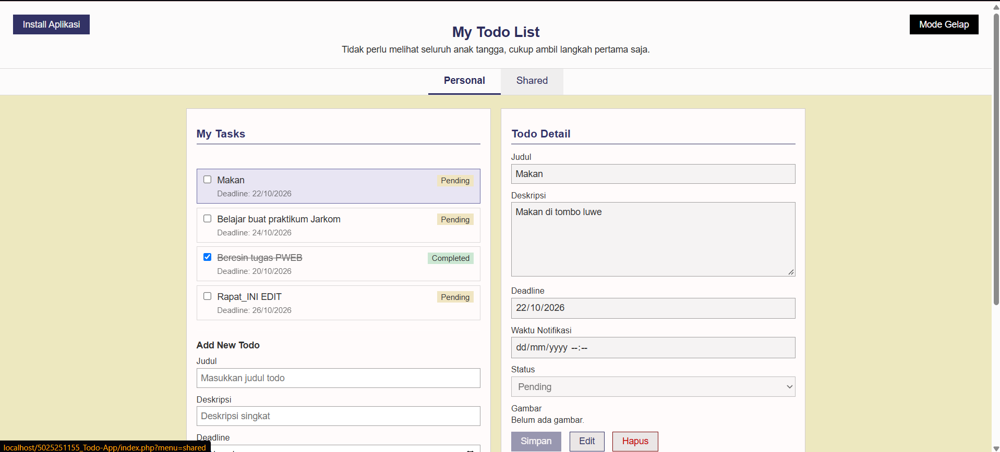
- Saat tombol ditekan, browser menampilkan dialog untuk memasang aplikasi.
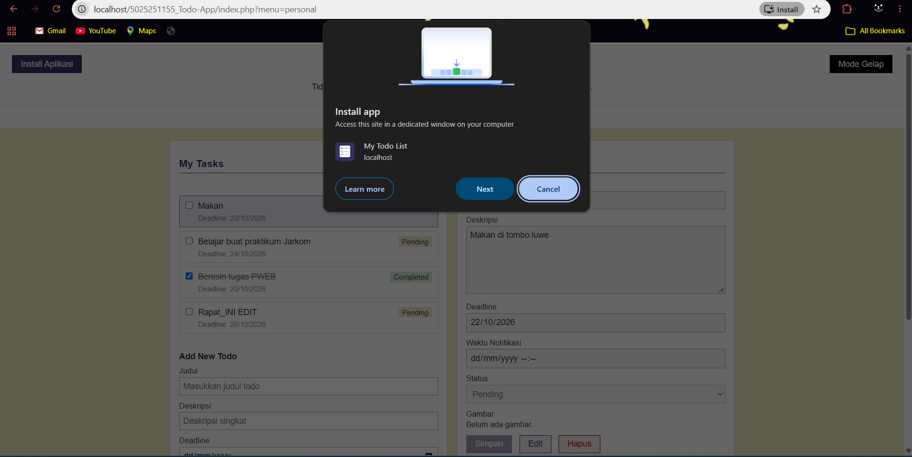
- Setelah instalasi selesai, Todo App dapat dibuka melalui window tersendiri dengan mode standalone.
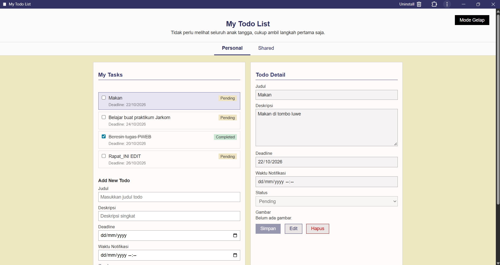

### 4. Pengujian Offline
- Pengujian dilakukan dengan mematikan koneksi melalui opsi Offline pada DevTools, kemudian melakukan reload halaman. Saat koneksi terputus, aplikasi menampilkan halaman offline.html.
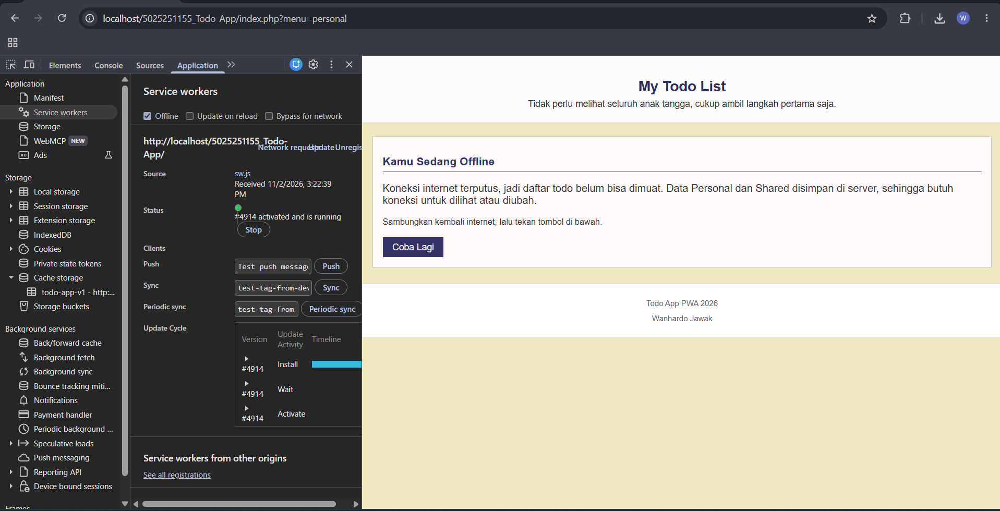
- Pada tab Network, halaman index.php?menu=personal ditangani oleh Service Worker dan ditampilkan sebagai ServiceWorker pada kolom Size. File style.css juga tetap berhasil dimuat.Request berwarna merah dengan tipe fetch dan initiator sw.js menunjukkan permintaan jaringan yang gagal karena koneksi terputus. Service Worker kemudian menampilkan halaman offline dari cache. Sementara itu, script.js tidak diminta oleh halaman offline, tetapi sudah tersimpan di Cache Storage.
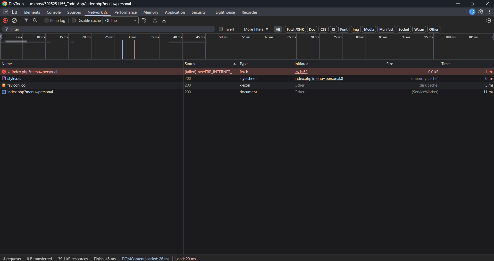
- Menambah atau mencentang todo saat offline ditolak dengan pesan peringatan
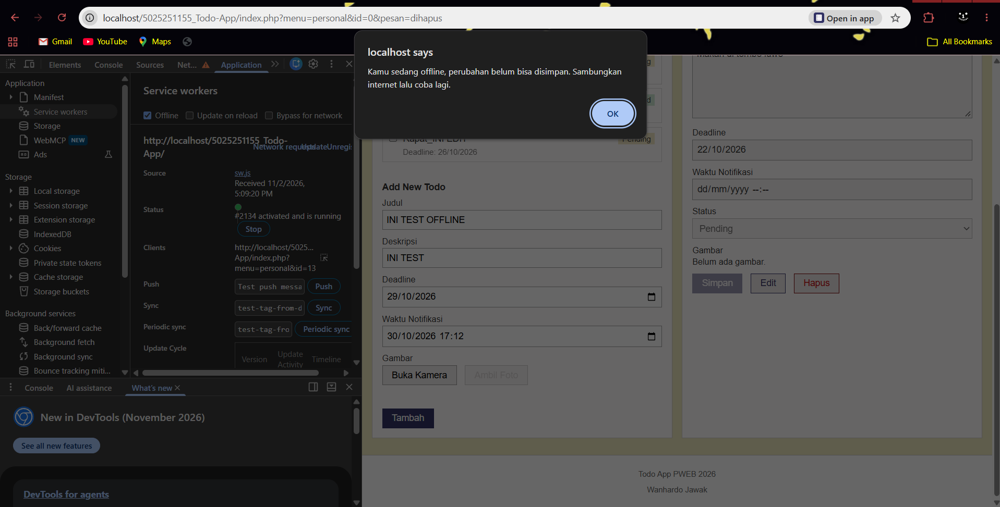
- Setelah online kembali dan tombol Coba Lagi ditekan, halaman todo tampil normal.
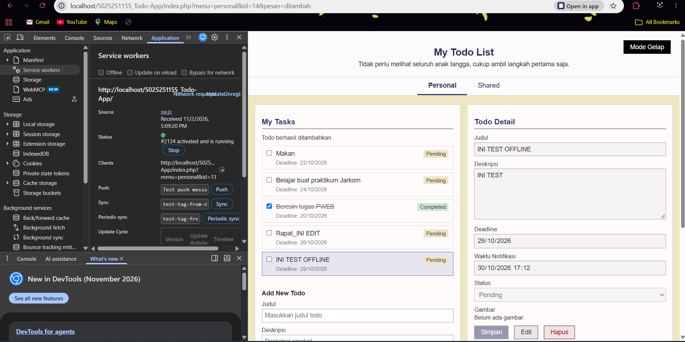
